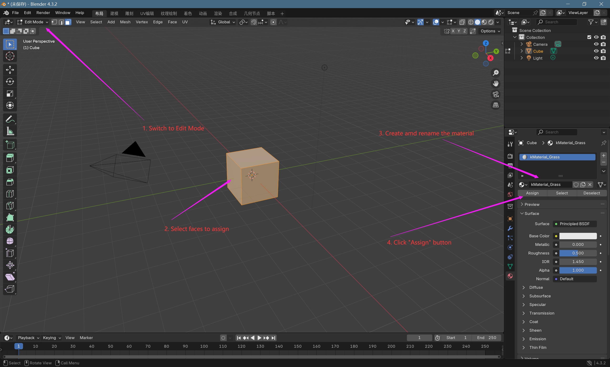

# That Sky Level
A simple level converter for Sky:CotL `BstBaked.meshes` version 0x3C or 0x3D, and a reader/writer for `Objects.level.bin` (TGCL) built on [SLDL](https://github.com/that-sky-project/that-sky-compiler).

## TODO
1. ❌Optimize performance (memory usage, subchunk allocation) of the `.meshes` converter.
1. ❌Support complex materials.
1. ❌Support cloud rendering and collision.
2. ❌Support 0x3D version of `.meshes`.

## Installation
```sh
npm i @that-sky-project/that-sky-level -g
```

## Usage
### Convert from `.obj` to `.meshes`
Before using the software, the Wavefront .obj file should be prepared. It's recommended to build files with Blender.

Most modeling formats use face materials, but `.meshes` stores data using vertex materials with weights. Therefore, this converter makes some simplifications when exporting to formats like `.obj` that do not support vertex colors, which may result in incorrect material output.

It is recommended to edit raw models with [Blender](https://www.blender.org/). Example operations are as follows:



The material name must start with `kMaterial_`. A complete material table can be found [here](./docs/materials.md).

While export the model as `Wavefront (.obj)` format, the model can be converted to `.meshes` with the command below.

```
node main.js --convert -i <model path> -o <output file>
```

The exported file defaults to version 0x3C, which may be incompatible with the latest version of the game.

### Convert `Objects.level.bin`
`Objects.level.bin` is read and written with [SLDL](https://github.com/that-sky-project/that-sky-compiler). The JSON files use `O$<object name>` keys:

```json
{
  "O$EntryPoint": {
    "$type": "AvatarSetPos",
    "autoStart": true
  }
}
```

The standard library declarations (`sldl-headers`) are always available. Classes that are not part of the standard library must be described by a declaration group, passed with `--decl`:

```
node main.js --serialize -i <level.json> -o <Objects.level.bin> [-d <level.decl.json>]
node main.js --deserialize -i <Objects.level.bin> -o <level.json> [-d <level.decl.json>]
```

When no declaration group is given, unknown classes are inferred from the binary while deserializing, so a custom `.decl.json` is required to write them back.
